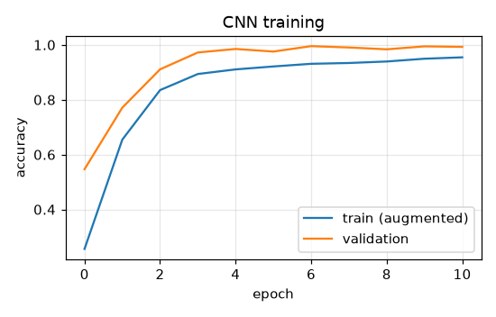
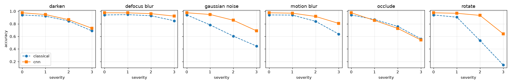
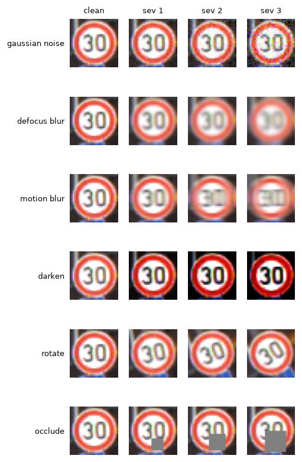
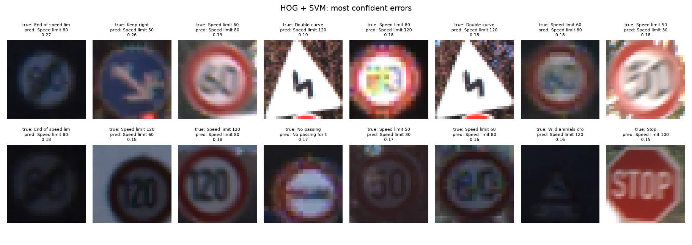
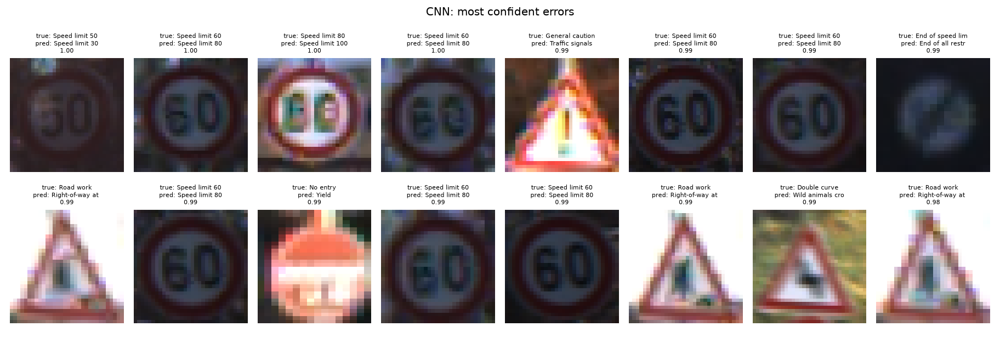

# Traffic-sign recognition: classical computer vision vs a CNN

[](https://github.com/HunaizaK/image-processing-classical-vs-deep/actions/workflows/ci.yml)

This project compares an OpenCV feature pipeline (contrast equalisation, HOG and a colour histogram, fed to a linear SVM) with a small Keras CNN. Both models are trained on the same 43-class German traffic-sign data and evaluated on the same test images. On top of accuracy, the project:

- tests whether the difference between the two models is statistically significant;
- checks how each model holds up when images are noisy, blurred, dark, rotated or partly blocked;
- looks at which signs each model gets wrong, and why;
- serves both models through a FastAPI endpoint for image uploads.

## Problem

A driver-assistance camera sees a cropped sign that is often small, blurred, dark or tilted, and has to name it. This project measures two things for that task:

- how much accuracy a learned CNN gains over hand-crafted features;
- what the CNN costs in model size and speed.

## Dataset

The data is [GTSRB](https://benchmark.ini.rub.de/gtsrb_dataset.html) (German Traffic Sign Recognition Benchmark): 43 classes of real road footage. The data step downloads the official archives and checks each one against a SHA-256 hash pinned in [configs/config.yaml](configs/config.yaml).

| Split | Images | Notes |
|---|---|---|
| Train | 33,299 | |
| Validation | 5,910 | 197 physical-sign tracks, held out as whole tracks |
| Test | 12,630 | the official test set, never used for tuning |

**Preprocessing.** Each image is cropped to the annotated sign region and resized to 32×32 with `INTER_AREA` interpolation. The prepared data is cached as one `.npz` file.

**Validation is split by sign, not by frame.** GTSRB records each physical sign as a *track* of about 30 consecutive frames. If frames were split at random, near-identical frames of the same sign would land in both training and validation. The pipeline measures this leakage directly by refitting with a random-frame split:

| Validation split | Classical validation accuracy |
|---|---|
| By track (used here) | 96.07% |
| Random frames | 98.34% (overstated by 2.3 points) |
| Official test set | 94.45% |

The track split's 96.07% is much closer to the test result than the random split's 98.34%.

## Approach

### Classical: one scikit-learn `Pipeline` that takes raw RGB images

1. **Contrast (CLAHE).** Contrast-limited adaptive histogram equalisation is applied to the lightness channel only (LAB colour space). This recovers dark, backlit signs without shifting their colours.
2. **Edges (HOG).** A histogram of oriented gradients is computed with `cv2.HOGDescriptor`: 4×4-pixel cells, 2×2-cell blocks, 9 orientation bins. Each overlapping block is normalised separately, which makes the features robust to uneven lighting. This gives 1,764 values per image.
3. **Colour.** A 16-bin hue histogram, weighted by saturation so that a grey background contributes little. It captures whether the sign is red, blue or yellow.
4. **Classifier.** `StandardScaler` followed by `LinearSVC`.

Because preprocessing is inside the pipeline, the saved `.joblib` file is the entire model. The API does not reimplement any feature code.

**Feature and C comparison** (validation accuracy; C is the SVM's regularisation setting, where a higher value fits the training data more tightly):

| Features | C=0.01 | C=0.03 | C=0.1 | C=0.3 |
|---|---|---|---|---|
| Grey pixels | 86.36 | **86.62** | 85.70 | 84.62 |
| HOG | **96.06** | 95.62 | 95.28 | 95.16 |
| HOG + CLAHE | **95.87** | 95.65 | 95.41 | 95.23 |
| HOG + CLAHE + colour | **96.07** | 95.75 | 95.33 | 95.26 |

- **HOG does most of the work:** about +9.4 points over raw pixels.
- **CLAHE and colour add almost nothing on top:** +0.01 points. CLAHE on its own slightly hurts, because HOG's block normalisation already corrects for lighting.
- **Stronger regularisation (lower C) is always better** with 1,780 features.

### CNN (Keras)

- **Input:** `uint8` images, rescaled inside the model, so the API passes raw pixels.
- **Training-time augmentation:** rotations up to about ±15°, shifts, zooms, and contrast and brightness changes. There are **no flips**, because flipping turns "Keep left" into "Keep right".
- **Architecture:** three convolution blocks (conv → batch norm → conv → batch norm → max-pool), then global average pooling, dropout 0.4, Dense(128), dropout 0.2, and a 43-way softmax. 310k parameters.
- **Training:** Adam optimiser at 1e-3. `EarlyStopping` (patience 4, restores the best weights) and `ReduceLROnPlateau`. Training stopped after 11 epochs, using the epoch-7 weights.

## Architecture

```
data.py ── download + SHA-256 check → ROI crop → 32×32 → track split → cache (.npz)
   │
   ├── classical.py   CLAHE · HOG · hue histogram → StandardScaler → LinearSVC  (feature/C comparison)
   ├── cnn.py         augmentation → 3 conv blocks → GAP → softmax
   │
   ├── robustness.py  6 OpenCV corruptions × 3 severities, fixed seeds
   ├── evaluate.py    McNemar, bootstrap CI, per-class / size / confusion analysis, figures
   └── pipeline.py    python -m signs {all,classical,cnn,robustness,report}
                         → artifacts/ (models)   reports/metrics.json + reports/figures/
serve.py ── FastAPI: POST /predict (image upload) · GET /health · SIGNS_BACKEND=cnn|classical
```

## Results

All numbers are from [reports/metrics.json](reports/metrics.json), produced by `make all`. Hardware: laptop CPU only.

| Model | Test accuracy (95% bootstrap CI) | Macro F1 | Size | Latency per image | Training time |
|---|---|---|---|---|---|
| HOG + CLAHE + colour + LinearSVC | 94.45% (94.05–94.80) | 0.922 | **0.66 MB** | **1.1 ms** | 6.5 min |
| Keras CNN | **97.70%** (97.43–97.94) | **0.965** | 3.85 MB | 39.5 ms | 12.7 min |

- **The gap is significant.** McNemar's exact test looks only at test images where the two models disagree: the CNN gets 584 of those right and the classical model gets 174 (p ≈ 1.4e-52).
- **The errors largely don't overlap.** The classical model makes 701 errors and the CNN 291; only 117 images fool both. Each model fails on images the other gets right.
- **Latency** is a single image on CPU, including feature extraction. It is measured one image at a time over 200 test images, so it includes Keras's per-call overhead; batching would be faster per image.



### Robustness

The robustness test uses 3,000 test images with fixed-seed corruptions at three severities.




| Corruption (severity 3) | Classical | CNN |
|---|---|---|
| Gaussian noise | 44.7% | **68.9%** |
| Defocus blur | 84.9% | **92.3%** |
| Motion blur | 63.7% | **80.7%** |
| Darken (gamma) | 68.8% | **73.0%** |
| Rotate | 14.5% | **64.0%** |
| Occlude | **56.1%** | 54.2% |

Averaged over all corruptions and severities, accuracy drops by **20.8 points for the classical model** and **12.8 points for the CNN**.

## Error and root-cause analysis

**Rotation breaks HOG.** At severity 2, the classical model falls from 94.1% to 53.3% while the CNN only falls to 93.4%. HOG bins gradients by absolute angle, so turning the sign by a few degrees moves all its edge energy into different bins. The CNN was trained with small rotations and its pooling layers absorb small shifts.

**Noise also breaks HOG.** HOG uses gradients, and pixel noise creates strong random gradients in every 4×4 cell. Block normalisation then scales that noise up alongside the real edges. The CNN's first convolutions act like learned smoothing filters, which suppresses the noise.

**Occlusion is the one case where the classical model holds up slightly better** (56.1% vs 54.2%). HOG is local: blocking one region only damages those cells, and the remaining cells still vote. The CNN tends to rely on a few strongly weighted regions, such as the digits on speed-limit signs, so losing one of those hurts it more. A next experiment would add random-erasing augmentation.

**Small, distant signs are the hardest for both models:**

| Original sign size | n | Classical | CNN |
|---|---|---|---|
| < 20 px | 1,173 | 84.5% | 92.4% |
| 20–29 px | 4,194 | 93.6% | 97.9% |
| 30–44 px | 3,795 | 96.0% | 98.1% |
| ≥ 45 px | 3,468 | 97.2% | 98.8% |

A sign under 20 px tall has been upscaled to 32×32, so it carries little real detail. The classical model loses 12.7 points between the largest and smallest bucket; the CNN loses 6.4.

**The most common confusion for both models is "Speed limit 60" read as "Speed limit 80"** (26 times for the classical model, 29 for the CNN). The two signs share the same red ring and differ only in the top-left stroke of one digit. In the error gallery, most of these images are dark and low-contrast, so at 32×32 that stroke is just a few pixels.

The classical model's other common confusions are between triangular warning signs: "Slippery road" read as "Wild animals crossing", "Road work" as "Road narrows on the right", and "Beware of ice/snow" as "Slippery road". These signs differ only in a small black symbol inside the same red triangle. HOG cells sized for the outline average away that symbol, which is also why "Beware of ice/snow" is one of the classical model's worst classes (68.7%).




**The CNN is wrong with high confidence.** Its 16 most confident errors all have softmax confidence of at least 0.98. These scores should not be used as a rejection threshold without calibration (for example, temperature scaling on the validation set). The classical model's top "confidence" is only a softmax over SVM margins (at most 0.27 among its errors) and is a ranking score, not a probability.

**Which model to use:** the CNN, wherever 40 ms on CPU is acceptable. It is 3.3 points more accurate and much more robust to noise, blur and rotation. The classical pipeline is still useful on a microcontroller-class device, where 0.66 MB and 1 ms matter, or as a cheap second opinion, since its errors overlap so little with the CNN's.

## How to run

```bash
python -m venv .venv && source .venv/bin/activate   # Windows: .venv\Scripts\activate
make install            # pinned dependencies + package
make all                # download GTSRB (~350 MB), train both models, robustness tests, report
make test               # 22 unit tests; no dataset needed
make serve              # http://localhost:8000/docs
```

Running individual steps: `python -m signs classical|cnn|robustness|report`. The full run took 4h 25m on a laptop CPU, almost all of it in the 16 SVM fits of the feature comparison; the CNN step took 13 min.

**Serving.** Set `SIGNS_BACKEND=cnn` (default) or `classical`. The API accepts PNG, JPEG or PPM uploads up to 5 MB, at any size; it resizes them the same way as in training. Example response for test image `00000.ppm`, whose true label is class 16:

```bash
curl -F "file=@00000.ppm" localhost:8000/predict
```
```json
{"backend": "cnn", "class_id": 16, "label": "Trucks prohibited", "confidence": 0.9988,
 "top3": [{"label": "Trucks prohibited", "score": 0.9988},
          {"label": "Speed limit 100", "score": 0.001},
          {"label": "No passing", "score": 0.0001}]}
```

**Docker:** run `make all` first, then `make docker`, then `docker run -p 8000:8000 signs`.

## What I learned

- **How you split the data can matter more than the model.** A random-frame split overstated accuracy by 2.3 points, about as much as the whole classical-vs-CNN gap.
- **Comparing features one at a time shows what is actually helping.** HOG supplied nearly all the gain. CLAHE, which I expected to help on dark images, added nothing, because HOG's block normalisation already corrects for lighting.
- **Clean test accuracy hides important differences.** The models are 3 points apart on clean images but 50 points apart on rotated ones. Robustness has to be tested directly.
- **Augmentation has to respect the labels.** Flipping is standard augmentation for photos, but it would turn "Keep left" into "Keep right" here.
- **High confidence is not the same as being correct.** The CNN's worst mistakes come with scores of 0.98 or more.
- **Putting all preprocessing inside the saved model** (a scikit-learn `Pipeline`, or Keras `Rescaling`) means training and the API resize and scale images through the same code.

## License

MIT
